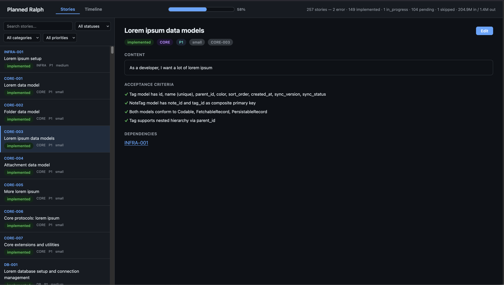
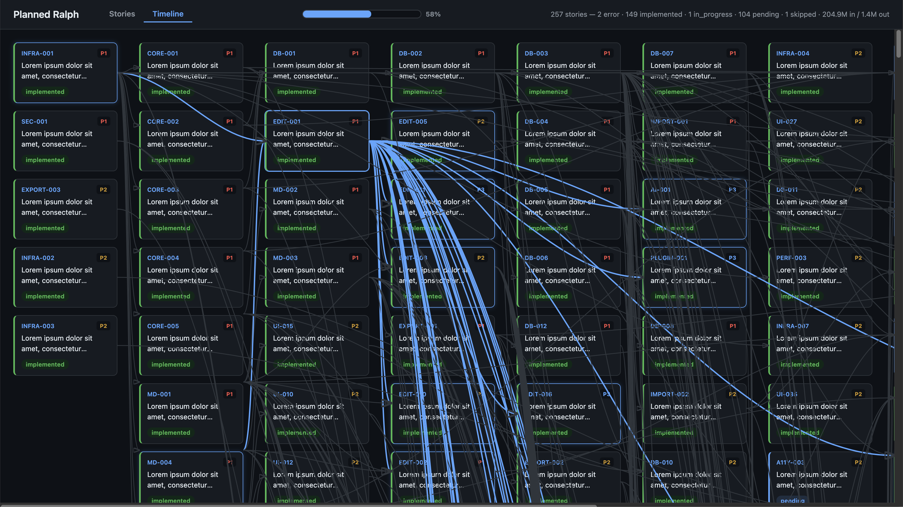

# pralph

**Planned Ralph** — a multi-phase AI development workflow that orchestrates [Claude Code](https://docs.anthropic.com/en/docs/claude-code) externally to automate the full software development lifecycle — from design to implementation.

## Table of contents

- [Background](#background)
- [How it works](#how-it-works)
- [Installation](#installation)
- [Usage](#usage)
  - [Standard workflow](#standard-workflow)
  - [Adding stories later](#adding-stories-later)
  - [Spec-driven development](#spec-driven-development)
  - [Linear mode](#linear-mode)
  - [Justloop](#justloop)
  - [Compound learning](#compound-learning)
  - [Index compaction](#index-compaction)
  - [Piping from stdin](#piping-from-stdin)
  - [Global options](#global-options)
  - [Command options](#command-options)
  - [Project state](#project-state)
- [Story viewer](#story-viewer)
- [Customization](#customization)
  - [Configuration](#configuration)
  - [Additional prompt files](#additional-prompt-files)
  - [Prompt template overrides](#prompt-template-overrides)
- [Acknowledgements](#acknowledgements)
- [License](#license)

## Background

pralph is inspired by the official [Ralph](https://github.com/anthropics/claude-code/tree/main/plugins/ralph-wiggum) plugin and [RalphX](https://github.com/jackneil/ralphx), which provide AI-driven product development workflows inside Claude Code. Unlike those tools, **pralph runs outside of Claude Code**, driving it as a subprocess. This means:

- **External orchestration** — pralph launches Claude Code invocations as child processes, managing sessions, streaming output, and coordinating multi-phase workflows from the outside.
- **Phase state persistence** — All state (design docs, stories, run logs) is tracked in a `.pralph/` directory, surviving across sessions and crashes.
- **Interactive takeover** — Press ESC during any Claude execution to drop into an interactive Claude Code session and resume manually.

> **Token usage warning:** pralph orchestrates multiple Claude Code sessions in a loop, each consuming tokens. A single `implement` run across a full backlog can use a significant amount of tokens. Use `--max-budget-usd` and `--max-iterations` to set limits, and monitor your usage.

## How it works

pralph breaks development into phases:

### Phase 1: Plan

Creates a comprehensive design document through interactive conversation with Claude. Researches best practices via web search and generates coding guardrails.

### Phase 1 (spec-driven): Spec

Instead of a design document in `.pralph/`, write a **specification that lives in the repository** (`specs/<name>/spec.md` + `design.md`) and is committed with the code. Requirements get stable IDs (`REQ-001`), stories trace back to them, and implementations are checked against them. Changing the software starts with changing the spec — pralph works out what that means for the backlog. See [Spec-driven development](#spec-driven-development).

### Phase 2: Stories

Extracts user stories from the design document (`stories`) or discovers missing requirements via web research (`webgen`). Stories are stored as structured JSONL with acceptance criteria, priority, complexity, and dependencies.

### Phase 2b: Add / Ideate / Refine

Manage stories on the fly:

- **`add`** — Turn a single idea into one well-formed story. Good for when something specific comes to mind mid-workflow. Use `--next` to flag it as priority 1 so it gets implemented next.
- **`ideate`** — Describe a high-level idea or feature area that was missed in the original design and let Claude break it down into multiple structured stories. Use this when you realize a broad concept was overlooked (e.g. "internationalization support") and want pralph to figure out the individual pieces.
- **`refine`** — Modify existing stories — split, merge, or rewrite them by ID or glob pattern.

### Phase 3: Implement

Autonomously implements stories one at a time from the backlog. Optionally runs a review loop after each implementation. Includes crash recovery — orphaned in-progress stories reset to pending on restart.

`pralph review --story-id AUTH-001` runs the reviewer by itself on a story that is already implemented — after changing `.pralph/review-prompt.md`, or after fixing something by hand. A rejection puts the story into rework, and `pralph implement --story-id AUTH-001` continues from the feedback.

### Linear

The plan can be turned into a [Linear](https://linear.app) project — a parent issue per story category, a sub-issue per story, blocking relations for dependencies — and executed from there: `implement` picks up the tickets, moves them through the workflow and comments on them, and respects whatever people change in Linear in the meantime. See [Linear mode](#linear-mode).

### Compound Learning

Inspired by the [compound-engineering-plugin](https://github.com/EveryInc/compound-engineering-plugin), compound learning captures non-trivial solutions as structured documentation after each implementation. Each documented solution compounds your team's knowledge — the first time you solve a problem takes research; document it, and the next occurrence takes minutes.

- **`--compound`** flag on `implement` — auto-captures learnings after each successful story
- **`compound`** standalone command — ad-hoc capture from recent work

Solutions are stored in `.pralph/solutions/` and automatically recalled during future plan and implement phases via keyword search.

#### Global compound learning

By default, solutions are scoped to the current project. Enable **global compound learning** to also save solutions to `~/.pralph/solutions/`, subdivided by auto-detected domain (e.g. `swift-ios`, `rust`, `docker`). This means learnings from one project automatically carry over to new projects in the same domain — no manual copying.

To opt in, set `global_compound` in your config (see [Configuration](#configuration)):

```json
// ~/.pralph/config.json
{
  "global_compound": true
}
```

**Recall is always global.** Even without `global_compound` enabled, plan and implement phases will search `~/.pralph/solutions/` for relevant learnings matching the project's detected domains. The setting only controls whether new solutions are *saved* globally.

**Domain detection** is automatic — pralph scans project files to determine domains:

| Files | Domain |
|---|---|
| `*.swift`, `Package.swift`, `*.xcodeproj` | `swift-ios` |
| `Cargo.toml`, `*.rs` | `rust` |
| `Dockerfile`, `docker-compose.yml` | `docker` |
| `*.py`, `pyproject.toml` | `python` |
| `*.ts`, `*.tsx`, `package.json` | `typescript` |
| `*.go`, `go.mod` | `go` |
| `*.tf` | `terraform` |
| ... | (40+ rules for common languages/platforms) |

A project can have multiple domains (e.g. a Rust service with Docker gets both `rust` and `docker` learnings). Override detection with `.pralph/domains.txt` (one domain per line) or the `--domain` CLI flag.

**Domain inference for global saves** — When saving a solution globally, pralph determines which domain(s) it belongs to using a three-tier fallback:

1. **Heuristics** (free, instant) — matches related files, tags, and error signatures against known patterns
2. **Haiku LLM** (cheap, ~1s) — if heuristics return nothing, asks Haiku to infer domains from the solution content
3. **All domains** (fallback) — only if both above fail, broadcasts to all detected domains

This prevents a Python-specific fix from polluting the `rust` or `docker` indexes.

#### Index compaction

Over time, solution indexes accumulate duplicates (re-captured solutions) and near-duplicates (same problem solved slightly differently across projects). The `compact-index` command uses Haiku to semantically merge them:

```bash
pralph compact-index              # compact local + global indexes
pralph compact-index --local-only  # only compact project-local index
pralph compact-index --global-only # only compact global indexes
pralph compact-index --yes         # skip the cost confirmation
pralph compact-index --full        # re-check everything, not just what is new
```

Compaction first groups entries that look like the same incident (same error signature, overlapping tags, same title prefix, same story) and only sends those groups to Haiku — entries with nothing similar never cost a call. Haiku merges near-duplicates into single comprehensive documents and removes stale entries; merged files are written back and superseded files are cleaned up. Entries whose solution file no longer exists are dropped from the index.

Before anything is sent, `compact-index` shows how many calls it will make and roughly what they cost, and asks for confirmation (`--yes` skips the question). Runs are incremental: a group that gained no entry since the last successful run is not sent again. `--full` re-checks every group.

The index is rewritten after each group, so an interrupted or partly failed run keeps the merges it already made, and solutions saved while a compaction is running are not lost. Set `PRALPH_COMPACT_ON_SAVE=1` to merge a new solution with its look-alikes right when it is saved.

```
~/.pralph/solutions/
  swift-ios/
    index.jsonl
    build-errors/
    ui-bugs/
  rust/
    index.jsonl
    build-errors/
    runtime-errors/
```

## Installation

**Prerequisites:** Python 3.10+, [Claude Code CLI](https://docs.anthropic.com/en/docs/claude-code) installed and authenticated.

```bash
git clone <repo-url> && cd my-ralph
./install.sh
```

This creates a virtualenv, installs dependencies, and adds `pralph` to your PATH.

## Usage

Run commands from inside any project directory. pralph stores its state in `.pralph/` within that directory.

### Standard workflow

```bash
# 1. Create a design document
pralph plan --prompt "Build a task management app with auth and real-time updates"

# 2. Extract stories from the design
pralph stories

# 3. Discover missing requirements via web research
pralph webgen

# Browse and edit stories in the web viewer
pralph viewer

# 4. Implement the backlog (review is on by default)
pralph implement --compound --max-iterations 30
```

### Adding stories later

After the initial backlog is built, you can add more stories at any time — then run `implement` again to pick them up.

```bash
# Add a single idea as a story (--next = implement it first)
pralph add --prompt "add dark mode support" --next

# Describe a broad idea — Claude splits it into stories
pralph ideate "add internationalization support with locale detection, translated UI strings, RTL layout, and date/currency formatting"

# Or point at a file with a longer description
pralph ideate --ideas-file ideas.txt

# Refine existing stories — split, merge, or rewrite
pralph refine -s AUTH-001 "split into login and registration"

# Ad-hoc capture of learnings
pralph compound --prompt "Fixed CORS issue by adding middleware"
pralph compound --story-id AUTH-001
```

### Spec-driven development

In spec-driven mode the source of truth is a specification **inside your repository**, versioned and reviewed like code:

```
specs/
  taskify/
    spec.md      # WHAT and WHY: requirements with stable IDs and acceptance criteria
    design.md    # HOW: technical design, referencing the requirement IDs
    tasks.md     # task list derived from the backlog (maintained by pralph)
```

```bash
# 1. Write the spec (instead of `pralph plan`), review it, commit it
pralph spec "Build a task management app with auth and real-time updates"
git add specs/ && git commit -m "Add taskify spec"

# 2. Derive stories — every story records the requirements it implements
pralph stories

# 3. See how the backlog covers the spec
pralph spec-status

# 4. Implement — against the spec, checked against the spec
pralph implement
```

**Requirements** are headings of the form `### REQ-001: Short title` (non-functional: `### NFR-001: ...`) followed by a statement and acceptance criteria. The IDs are permanent: stories, commits and tickets refer to them. Bullet-style requirements (`- **FR-001**: The system MUST ...`) are recognized too, so specs written by hand or with other spec tooling work as they are.

pralph writes the spec but leaves committing it to you — a spec is worth reading before it becomes the source of truth. If you skip that, the first implementation commits the spec files along with its change.

**Changing the software starts with changing the spec.** Edit `spec.md` yourself, or let pralph do it:

```bash
pralph spec "Tasks can have a due date; overdue tasks are highlighted"
pralph stories      # derives stories only for what is new or changed
pralph implement
```

pralph compares the spec with the backlog on every `stories` run:

| Spec vs. backlog | What happens |
|---|---|
| Requirement without stories | Stories are generated for it |
| Requirement text edited after its stories were written | Follow-up stories are generated for the difference (whitespace-only edits are ignored) |
| Requirement removed, stories still pending | Reported by `stories` and `spec-status` — `refine` or skip them |
| Story that traces to no requirement | Reported by `spec-status` |

What spec-driven mode changes in the other phases:

- **`stories`** extracts from the specs only — no research mode, because every story has to trace to a requirement. If something is missing, amend the spec first.
- **`implement`** gives Claude the exact text of the requirements the story implements, plus the spec and design files. Code and spec may not diverge: if the spec turns out to be wrong, the implementation fixes the spec in the same commit and notes it in the spec's changelog. The story's box in `tasks.md` is ticked in that commit too.
- **Review** additionally checks conformance to the spec and rejects implementations that contradict it.
- **`add`, `ideate`, `refine`, `webgen`** use the specs as their planning context. Stories they create without a requirement show up as untraced in `spec-status`.

The mode switches on by itself as soon as the repository contains a spec (`specs/<name>/spec.md`). Several specs can live side by side — one per feature area, for instance — selected with `pralph spec --name payments "..."`. Already have a `.pralph/design-doc.md`? `pralph spec` reads it and carries it over into the new spec.

```
$ pralph spec-status

  specs/taskify/spec.md — 4 requirements: 2 done, 1 in progress, 1 uncovered
    ✓ REQ-001  Create tasks
      TASK-001 [implemented], TASK-002 [implemented]
    ◐ REQ-002  Complete tasks  (changed since stories were written)
      TASK-003 [implemented]
    ✗ REQ-003  Due dates
      no stories
    ...
  1 requirements without stories, 1 changed — run pralph stories
```

To use a different directory, set `spec_dir` in the [configuration](#configuration); to keep pralph from treating an existing `specs/` directory as its own, set `"spec_driven": false`.

### Linear mode

Turn the whole plan into a Linear project and run the implementation off the tickets.

```bash
export LINEAR_API_KEY=lin_api_...     # Linear → Settings → Security & access → Personal API keys

pralph linear push --dry-run          # show what would be created
pralph linear push --team ENG         # create the project, parent issues and sub-issues
pralph implement                      # now works off the Linear project
```

`pralph linear push` creates:

- a **project**, named after the plan, with the design document (or spec) as its content
- a **parent issue per story category** (`AUTH — Authentication`, `API — API`, ...)
- a **sub-issue per story** (`AUTH-001: Login form`) with the story text, the acceptance criteria as a checklist, and the priority
- **blocking relations** for story dependencies

It is safe to re-run: only what is missing gets created. Stories added later (`add`, `ideate`, `stories`, ...) get their tickets automatically.

Once the project is linked, **Linear is the source of truth for what gets worked on**. Before every story, `implement` syncs with the project:

| In Linear | Effect on the run |
|---|---|
| Title, description, acceptance criteria or priority edited | The story is implemented as the ticket now reads |
| Issue created in the project (or as a sub-issue) | Becomes a story and is implemented |
| Issue canceled, marked as duplicate, or removed from the project | Skipped |
| Issue moved to a started state by someone | Left alone — a person is working on it. Picked up again if it goes back to Todo |
| Issue completed by someone | Treated as implemented |
| Done issue moved back to Todo | Implemented again |
| Blocking relation added or removed | Dependency order changes accordingly |
| Sub-issues added to a story ticket | The sub-issues are implemented instead of the parent |

And pralph reports back on the ticket:

| pralph | In Linear |
|---|---|
| Starts a story | Issue → In Progress (and its parent issue, if not started yet) |
| Implements it and the review passes | Issue → Done, comment with the summary, changed files and review verdict. The parent closes with its last sub-issue |
| Implements it but the reviewer itself fails | As above, and the comment says the story was **not reviewed** and why |
| Review rejects it | Stays In Progress, comment with the review feedback |
| Fails | Stays In Progress, comment with the error. Move it to Todo (or run `pralph reset-errors`) to retry |
| Skips it / finds a duplicate | Issue → Canceled, comment with the reason (and what it duplicates) |

Acceptance criteria are read from the list under an `Acceptance criteria`, `Done when` or `Definition of done` heading in the issue description — a markdown heading, a bold line or a plain `Done when:` line. If your tickets use another heading, name it in the [configuration](#configuration): `"linear_ac_heading": "Fertig wenn"` (or a list of headings). The first configured heading is also the one pralph writes into the tickets it creates.

The implementation is told to mention the issue identifier (`ENG-123`) in its commit message, so Linear's GitHub/GitLab integration links the commits to the ticket.

If Linear cannot be reached during a run, pralph continues with the backlog as last synced and catches up on the missed updates at the next sync.

```bash
pralph linear status                  # link, and ticket states as of the last sync
pralph linear pull                    # sync now (implement does this by itself)
pralph implement --story-id ENG-123   # a Linear identifier works as a story ID
pralph implement --no-linear          # run without touching Linear

# On a fresh clone: attach to the existing project and rebuild the backlog from its tickets
pralph linear link https://linear.app/acme/project/shop-1a2b3c4d5e6f
```

#### Sharing a project: scope

A Linear project often holds more than one repository's work, and other people's tickets. Scope the link, and only matching issues become work:

```bash
pralph linear link https://linear.app/acme/project/platform-1a2b3c4d5e6f --label repo:shop
pralph linear scope --milestone "Base work" --assignee me   # change it later; criteria combine
pralph linear scope                                         # show it
pralph linear scope --clear                                 # back to the whole project
```

| Option | In scope |
|---|---|
| `--milestone NAME` | Issues in this project milestone |
| `--assignee me\|NAME\|EMAIL` | Issues assigned to this user |
| `--label NAME` | Issues with this label (a label of the team or of the workspace) |

An issue has to match every criterion that is set. Everything else in the project is left alone: it never becomes a story, and pralph never writes to it — no state change, no comment, no relation. That includes parent issues: a parent outside the scope is not moved, and a parent inside it is not closed while it has open sub-issues outside the scope.

An issue that leaves the scope — reassigned, moved to another milestone, label removed — is dropped from the run (its story is skipped locally) and its ticket is not touched again; if it comes back, so does the story. Tickets pralph creates for new stories get the milestone, assignee and label of the scope, so they are part of it.

`pralph implement --story-id ENG-123` works with a scope as well, and accepts a ticket this checkout has not seen yet.

#### Someone else's project: read-mostly

In a project that people run, closing and canceling tickets is theirs to do — typically Done happens when the pull request merges. A read-mostly link keeps pralph to two things: **comments**, and the move to **In Progress**.

```bash
pralph linear link https://linear.app/acme/project/platform-1a2b3c4d5e6f --label repo:shop --read-mostly
pralph linear scope --read-mostly      # or switch an existing link
pralph linear scope --read-write       # back to the full sync
```

| pralph | In Linear, read-mostly |
|---|---|
| Starts a story | Issue → In Progress |
| Implements it and the review passes | Comment with the summary, changed files and review verdict. The issue **stays In Progress** — Linear's GitHub integration (or a person) closes it on merge |
| Review rejects it / it fails | Comment with the feedback or the error |
| Skips it / finds a duplicate | Comment saying so. The issue is **not canceled** |
| Is interrupted | Nothing — the issue is not moved back to Todo |
| New story (`add`, `ideate`, ...) | Stays local. No issue, no parent issue, no blocking relation is ever created, and `pralph linear push` refuses |
| Parent issues | Never moved |

Everything in the first table still applies: what people change in Linear is respected. A ticket moved to Done counts as implemented, one moved back to Todo is implemented again.

The link is stored in `.pralph/linear.json`. The API key is read from `LINEAR_API_KEY`, or from `linear_api_key` in `~/.pralph/config.json` — don't put it in a config file that gets committed.

Linear mode and spec-driven mode combine: the project content is a snapshot of the spec, and each sub-issue names the requirements it implements.

### Justloop

A simple loop for running any prompt to completion without the full plan/stories/implement workflow. Give it a task and pralph handles the rest — it wraps the prompt with proper end conditions, runs it in a loop, and stops when Claude signals the task is done.

```bash
# Positional arguments
pralph justloop "refactor the auth module to use JWT tokens"

# Multi-word prompts work naturally
pralph justloop fix all linting errors and update deprecated API calls

# Via --prompt flag
pralph justloop --prompt "add comprehensive test coverage for the utils module"

# Piped from stdin
gh issue view 42 --json body -q .body | pralph justloop

# Reset and re-run
pralph justloop --reset "migrate database schema to v2"
```

Each iteration has full tool access (Read, Write, Edit, Bash, Glob, Grep) and resume context from prior iterations. The loop terminates when Claude determines the task is fully complete, after 5 consecutive errors, or when max iterations is reached.

**Tip: review-driven fix loop** — A powerful pattern is to first run Claude Code's `/review` command on your codebase and have it write the issues to a file, then let justloop work through them one by one:

```bash
# Step 1: In Claude Code, run /review and ask it to save issues to a markdown file
#   e.g. "/review the codebase and write all issues to issues.md, ordered by severity"

# Step 2: Let justloop fix them
pralph justloop "Read issues.md. Pick the highest severity unresolved issue, fix it, then update issues.md to mark it as resolved."
```

Each iteration fixes one issue and updates the tracking file, giving you a clean audit trail. The loop stops when all issues are resolved.

### Compound learning

Inspired by the [compound-engineering-plugin](https://github.com/EveryInc/compound-engineering-plugin), compound learning captures non-trivial solutions as structured documentation after each implementation.

The value compounds over time. The first time Claude hits a tricky CORS config, it burns tokens researching. Document that solution, and the next project that needs CORS gets it right on the first iteration. Build errors, deployment quirks, library gotchas, auth patterns — every solution captured makes subsequent implementations faster, cheaper, and more reliable. Early runs are slow; later runs benefit from everything that came before.

Solutions are stored in `.pralph/solutions/` and automatically recalled during future plan and implement phases via keyword search — no manual lookup needed. With [global compound learning](#global-compound-learning) enabled, solutions are also saved to `~/.pralph/solutions/{domain}/` and automatically recalled in new projects that share the same domain.

```bash
# Auto-capture learnings after each successful story
pralph implement --compound

# Ad-hoc capture from recent work
pralph compound --prompt "Fixed CORS issue by adding middleware"
pralph compound --story-id AUTH-001
```

### Piping from stdin

All commands that accept `--prompt` also read from stdin when piped, making it easy to compose with other tools:

```bash
echo "Build a calculator app" | pralph plan
echo "add dark mode" | pralph add
echo "internationalization support" | pralph ideate
echo "split into login and registration" | pralph refine -s AUTH-001
echo "use vanilla JS" | pralph implement
echo "Fixed CORS issue by adding middleware" | pralph compound
echo "fix all linting errors" | pralph justloop

# Compose with other tools
cat requirements.txt | pralph plan
gh issue view 42 --json body -q .body | pralph add --next
```

Input is resolved in order: `--prompt` flag > stdin pipe > interactive prompt.

### Global options

| Option | Default | Description |
|---|---|---|
| `--model` | `opus` | Model alias or full Claude model name |
| `--max-iterations` | `50` | Max loop iterations per phase |
| `--max-budget-usd` | — | Cost limit per Claude invocation |
| `--cooldown` | `5` | Seconds between iterations |
| `--verbose` | off | Show full Claude output |
| `--project-dir` | `.` | Target project directory |
| `--dangerously-skip-permissions` | off | Bypass Claude Code permission checks |
| `--extra-tools` | — | Additional MCP tools (comma-separated) |
| `--domain` | auto | Override detected domains for global learning (repeatable) |

### Command options

#### `plan`

| Option | Default | Description |
|---|---|---|
| `--prompt` | — | Guidance for design doc creation |
| `--reset` | off | Reset phase state and start fresh |

#### `spec`

Accepts the request as positional arguments (e.g. `pralph spec "tasks can have due dates"`). On an existing spec the request is treated as a change to make; without a request the spec is refined.

| Option | Default | Description |
|---|---|---|
| `-n`, `--name` | the only spec, else the project name | Spec name = directory under `specs/` |
| `--prompt` | — | Request (alternative to positional args) |
| `--reset` | off | Reset phase state and start fresh |

#### `stories`

| Option | Default | Description |
|---|---|---|
| `--extract-weight` | `80` | Extract vs research weight (0–100). Ignored in spec-driven mode |
| `--reset` | off | Reset phase state and start fresh |

#### `webgen`

| Option | Default | Description |
|---|---|---|
| `--reset` | off | Reset phase state and start fresh |

#### `add`

| Option | Default | Description |
|---|---|---|
| `--prompt` | — | Brief idea to turn into a story (prompted if omitted) |
| `--next` | off | Priority 1 — implement next |
| `--anytime` | off | Let Claude pick priority |

#### `ideate`

Accepts ideas as positional arguments (e.g. `pralph ideate "idea one" "idea two"`).

| Option | Default | Description |
|---|---|---|
| `--ideas-file` | — | Path to ideas file (default: `.pralph/ideas.md`) |
| `--prompt` | — | Ideas as inline text |
| `--reset` | off | Reset phase state and start fresh |

#### `refine`

Accepts an optional positional instruction (e.g. `pralph refine -s AUTH-001 "split into login and registration"`).

| Option | Default | Description |
|---|---|---|
| `--prompt` | — | Refinement instruction (alternative to positional arg) |
| `-s`, `--story` | — | Story ID(s) to refine (repeatable) |
| `-p`, `--pattern` | — | Glob pattern to match story IDs (e.g. `I18N-*`) |

#### `implement`

| Option | Default | Description |
|---|---|---|
| `--story-id` | — | Implement a specific story. If the review rejects it, it is reworked with the feedback until the review approves — at most `--max-iterations` rounds |
| `--phase1` / `--no-phase1` | on | Architecture-first grouping |
| `--review` / `--no-review` | on | Run reviewer after each implementation |
| `--compound` / `--no-compound` | off | Capture learnings after each story |
| `--prompt` | — | Guidance for implementation (e.g. "use FastAPI") |
| `--linear` / `--no-linear` | on when linked | Work off the linked Linear project |
| `--reset` | off | Reset phase state and start fresh |

#### `linear`

| Command | Description |
|---|---|
| `linear push` | Create the Linear project, parent issues, sub-issues and blocking relations for everything not in Linear yet |
| `linear pull` | Sync the backlog from the Linear project |
| `linear link PROJECT` | Attach to an existing Linear project (URL, ID or name) and rebuild the backlog from it. Takes the scope options below |
| `linear scope` | Show or change which issues of the project are this checkout's work, and whether the link is read-mostly |
| `linear status` | Show the link and the ticket states as of the last sync |

`linear push` options:

| Option | Default | Description |
|---|---|---|
| `--team` | config `linear_team`, or the only team | Linear team key (e.g. `ENG`) |
| `--project` | title of the plan | Name of the Linear project |
| `--dry-run` | off | Show what would be created without calling Linear |

`linear link` and `linear scope` options:

| Option | Default | Description |
|---|---|---|
| `--milestone` | — | Only issues in this project milestone |
| `--assignee` | — | Only issues assigned to this user: `me`, a name or an email |
| `--label` | — | Only issues with this label |
| `--clear` | off | `linear scope` only: drop the current scope first |
| `--read-mostly` | off | Only comment and move issues to In Progress. `linear scope` also takes `--read-write` to switch back |
| `--team` | — | `linear link` only: team key, if the project belongs to several teams |

#### `review`

| Option | Default | Description |
|---|---|---|
| `--story-id`, `-s` | required | Story to review (story ID or Linear identifier). Must be implemented or in rework |

Exits with 1 when the review rejects the story or cannot run.

#### `justloop`

Accepts the task as positional arguments (e.g. `pralph justloop fix all linting errors`).

| Option | Default | Description |
|---|---|---|
| `--prompt` | — | Task prompt (alternative to positional args) |
| `--reset` | off | Reset phase state and start fresh |

#### `compound`

| Option | Default | Description |
|---|---|---|
| `--story-id` | — | Story ID to capture learnings from |
| `--prompt` | — | Description of what was done |

#### `compact-index`

| Option | Default | Description |
|---|---|---|
| `--global-only` | off | Only compact global indexes |
| `--local-only` | off | Only compact project-local index |
| `--yes`, `-y` | off | Skip the cost-estimate confirmation |
| `--full` | off | Re-check every group of similar entries, not only those that gained entries since the last run |

Uses Haiku to semantically merge duplicate solutions and prune orphans. See [Index compaction](#index-compaction).

#### `spec-status`

No options. Shows every requirement of every spec with the stories that implement it and their status, flags requirements that changed since their stories were written, and lists stories that trace to no requirement (or to one that no longer exists).

#### `reset-errors`

No options. Resets all stories with `error` status back to `pending` and clears the current phase's error state (`consecutive_errors`, `last_error`, and `completion_reason` if the phase was stopped due to errors). This unblocks a phase that halted after hitting too many consecutive errors.

```bash
pralph reset-errors
```

#### `viewer`

| Option | Default | Description |
|---|---|---|
| `--port` | `8411` | Port to serve on |
| `--no-open` | off | Don't auto-open browser |

### Project state

All state lives in `.pralph/` within your project — except the spec, which in [spec-driven mode](#spec-driven-development) lives in the repository itself (`specs/`) and is meant to be committed:

```
specs/                  # Spec-driven mode: the specification (commit this)
  <name>/
    spec.md             # Requirements
    design.md           # Technical design
    tasks.md            # Task list, maintained by pralph

.pralph/
  config.json           # Project-level config overrides (optional)
  domains.txt           # Override auto-detected domains (optional)
  design-doc.md         # Design document (Phase 1)
  spec-baseline.json    # Spec-driven mode: requirement text the backlog was derived from
  linear.json           # Linear mode: linked team, project, scope and parent issues
  guardrails.md         # Coding standards and constraints
  stories.jsonl         # Story backlog
  status.jsonl          # Story status history
  phase-state.json      # Current phase progress
  run-log.jsonl         # Iteration log
  review-feedback/      # Per-story review notes
  prompts/              # Project-level prompt overrides
  solutions/            # Compound learning knowledge base
    index.jsonl         # Lightweight index for fast keyword search
    build-errors/       # Categorized solution documents
    runtime-errors/
    ...
```

Global state lives in `~/.pralph/`:

```
~/.pralph/
  config.json           # User-wide config defaults
  prompts/              # User-wide prompt template overrides
  solutions/            # Global compound learning (domain-scoped)
    swift-ios/          # One directory per detected domain
      index.jsonl
      build-errors/
      ui-bugs/
    rust/
      index.jsonl
      runtime-errors/
    ...
```

## Story viewer

```bash
pralph viewer            # opens http://localhost:8411
pralph viewer --port 9000 --no-open
```

A dark-themed web UI for browsing and managing your story backlog. Features:

- **Sidebar + detail panel** — click any story to see its full content, acceptance criteria, dependencies, and metadata.
- **Filtering** — filter by status, category, priority, or search by text.
- **In-place editing** — edit story fields (title, content, priority, status, etc.) directly in the browser and save back to disk.
- **Timeline view** — a Gantt-style visualization that lays out stories by dependency depth, with arrows showing dependency relationships.




## Customization

### Configuration

pralph uses JSON config files for persistent settings. Config is resolved in order: project `.pralph/config.json` > user `~/.pralph/config.json` > defaults.

```json
// ~/.pralph/config.json
{
  "global_compound": true
}
```

| Key | Type | Default | Description |
|---|---|---|---|
| `global_compound` | `bool` | `false` | Save compound learnings to `~/.pralph/solutions/{domain}/` for cross-project reuse |
| `spec_dir` | `string` | `"specs"` | Directory (inside the project) that holds the specs |
| `spec_driven` | `bool` | auto | Force spec-driven mode on or off. By default it is on when `<spec_dir>/<name>/spec.md` exists |
| `linear_team` | `string` | — | Default Linear team key for `pralph linear push` |
| `linear_ac_heading` | `string` or list | — | Heading(s) that introduce the acceptance criteria in a Linear issue, in addition to `Acceptance criteria`, `Done when` and `Definition of done` |
| `linear_api_key` | `string` | — | Linear API key, if not set via `LINEAR_API_KEY`. Keep it in `~/.pralph/config.json`, not in the project |

Set user-wide defaults in `~/.pralph/config.json`. Override per-project in `.pralph/config.json` (e.g. disable global saving for a throwaway project).

### Additional prompt files

These files live directly in `.pralph/` and provide extra context that gets appended to the built-in prompts. Create them when you want to steer Claude's behavior without replacing the entire prompt.

| File | Description |
|---|---|
| `guardrails.md` | Project-specific coding standards and constraints injected into every phase |
| `extra-tools.txt` | Additional MCP tools to enable (one per line), merged with `--extra-tools` CLI flag (see example below) |
| `plan-prompt.md` | Extra context appended to plan phase prompts |
| `spec-prompt.md` | Extra context appended to spec phase prompts |
| `implement-prompt.md` | Extra context appended to implement phase prompts |
| `review-prompt.md` | Project-specific review guidelines injected into the review template |

For example, adding a `guardrails.md` with "Always use TypeScript strict mode" will influence every phase without needing to touch the underlying prompts.

**extra-tools.txt example** — grant Claude access to MCP tools by listing specific tool names or using wildcards:

```
# Specific Jira tools
mcp__jira__get_issue
mcp__jira__search_issues
mcp__jira__create_issue

# Or allow all tools from the Jira MCP server
mcp__jira__*
```

You can also pass these on the command line: `pralph implement --extra-tools "mcp__jira__*"`

### Prompt template overrides

For full control, you can replace any built-in prompt entirely. Templates are resolved in order:

1. **Project-level** — `.pralph/prompts/<name>.md`
2. **Home-level** — `~/.pralph/prompts/<name>.md`
3. **Built-in default** — falls back to the bundled prompt

Use project-level overrides to tailor behavior for a specific project, or home-level overrides for personal defaults across all projects.

| Template | Phase | Description |
|---|---|---|
| `plan-initial.md` | Plan | First design document creation |
| `plan-iteration.md` | Plan | Iterative design refinement |
| `spec-initial.md` | Spec | First creation of an in-repo spec |
| `spec-iteration.md` | Spec | Refining or amending a spec |
| `stories-extract.md` | Stories | Extracting stories from design doc |
| `stories-spec.md` | Stories | Deriving stories from the specs (spec-driven mode) |
| `stories-research.md` | Stories | Research mode for best practices |
| `stories-webgen.md` | Stories | Web-based requirements discovery |
| `add.md` | Add | Creating a single story from an idea |
| `ideate.md` | Ideate | Breaking a high-level idea into stories |
| `refine.md` | Refine | Splitting, merging, or rewriting stories |
| `implement.md` | Implement | Single story implementation |
| `implement-phase1-analyze.md` | Implement | Architecture-first grouping analysis |
| `implement-phase1.md` | Implement | Phase 1 batch implementation |
| `review.md` | Implement | Code review after implementation |
| `spec-implement.md` | Implement | Spec section appended to the implement prompt (spec-driven mode) |
| `spec-review.md` | Implement | Spec conformance section of the review prompt (spec-driven mode) |
| `justloop.md` | Justloop | Task execution prompt with completion signal |
| `compound.md` | Compound | Solution capture after implementation |
| `compact.md` | Compact | Semantic merging of duplicate solutions |

Templates use `{{variable}}` placeholders that are substituted at runtime (e.g. `{{design_doc}}`, `{{user_prompt}}`, `{{existing_stories}}`). Check the built-in defaults in `pralph/prompts/` to see which variables each template expects.

## Acknowledgements

pralph is heavily inspired by:

- **[Ralph](https://github.com/anthropics/claude-code/tree/main/plugins/ralph-wiggum)** — Anthropic's official Claude Code plugin for AI-driven product development workflows.
- **[RalphX](https://github.com/jackneil/ralphx)** — The extended version of Ralph with multi-phase planning, story extraction, and implementation loops.

- **[compound-engineering-plugin](https://github.com/EveryInc/compound-engineering-plugin)** — Every Inc's compound learning plugin whose philosophy of documenting solutions to build institutional knowledge inspired pralph's compound learning feature.

pralph reimplements and extends these ideas with an external orchestration approach, driving Claude Code as a subprocess rather than running as a plugin within it.

## License

MIT
